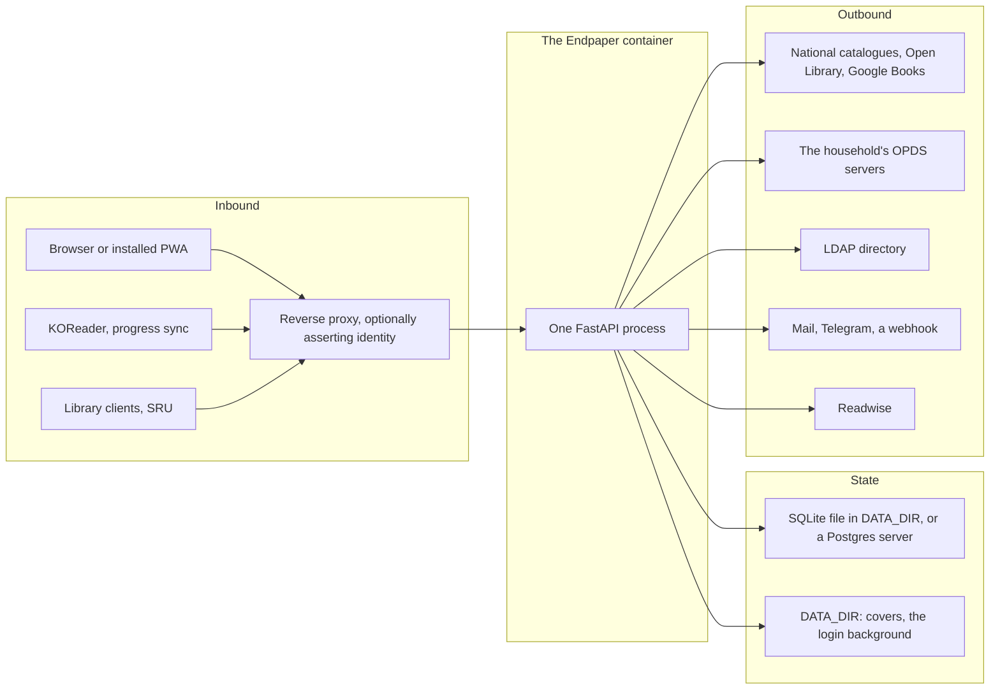
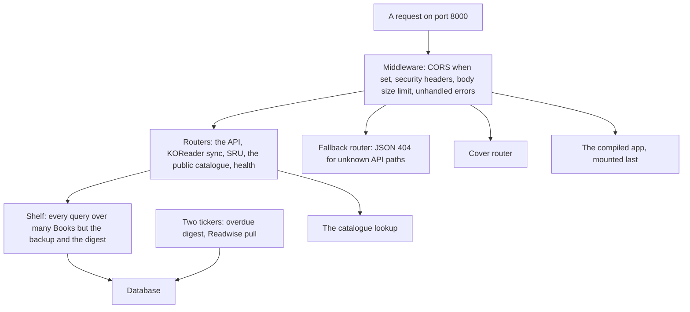
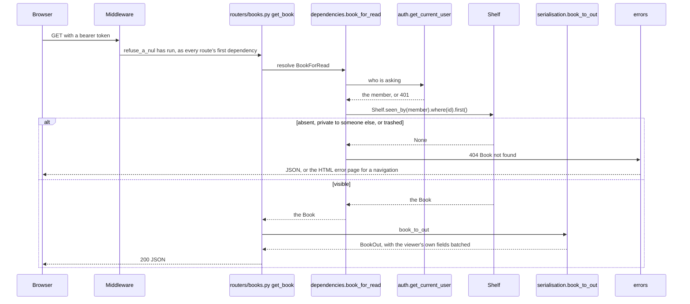
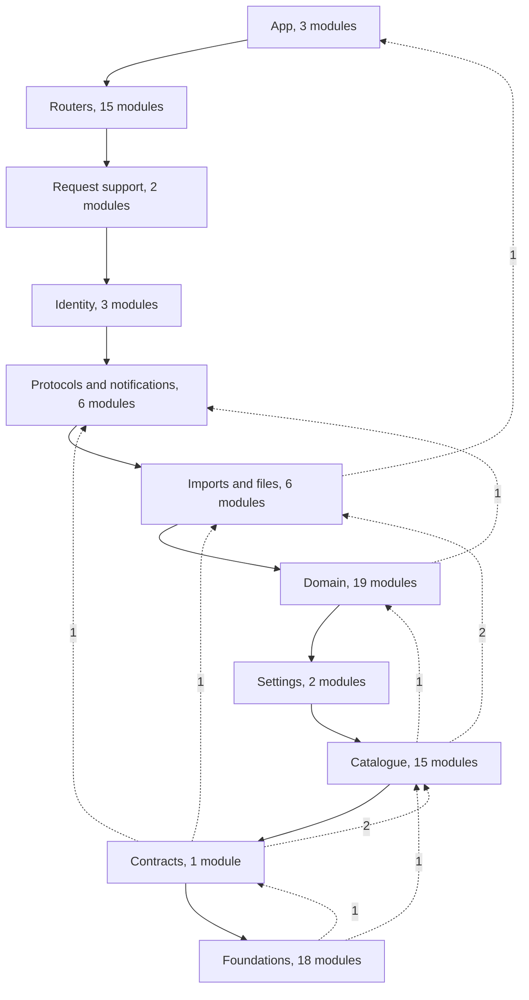
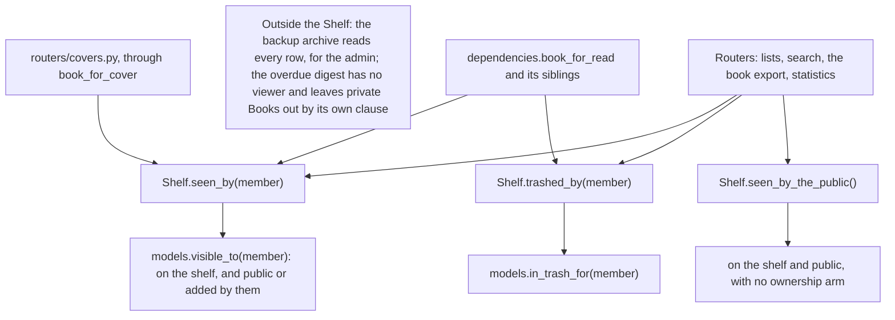
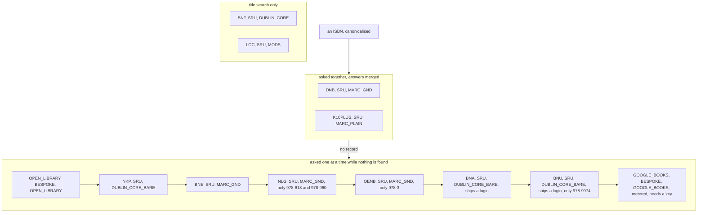
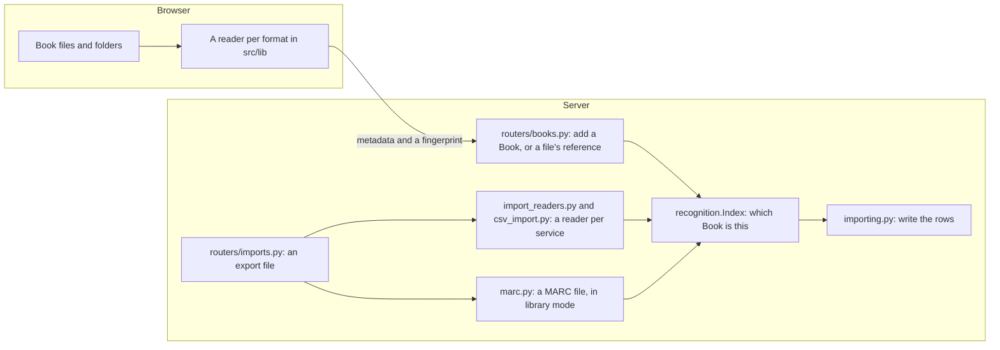
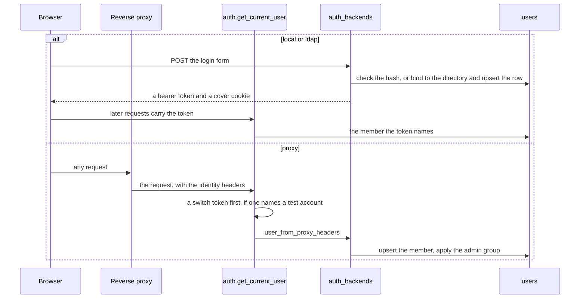
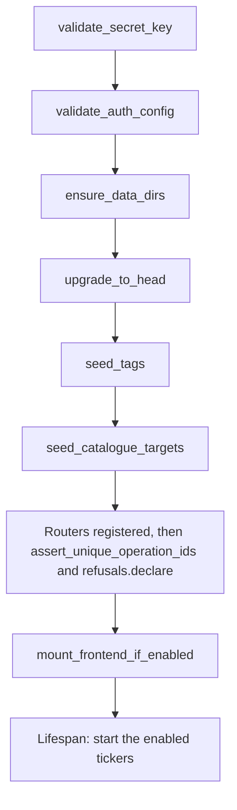
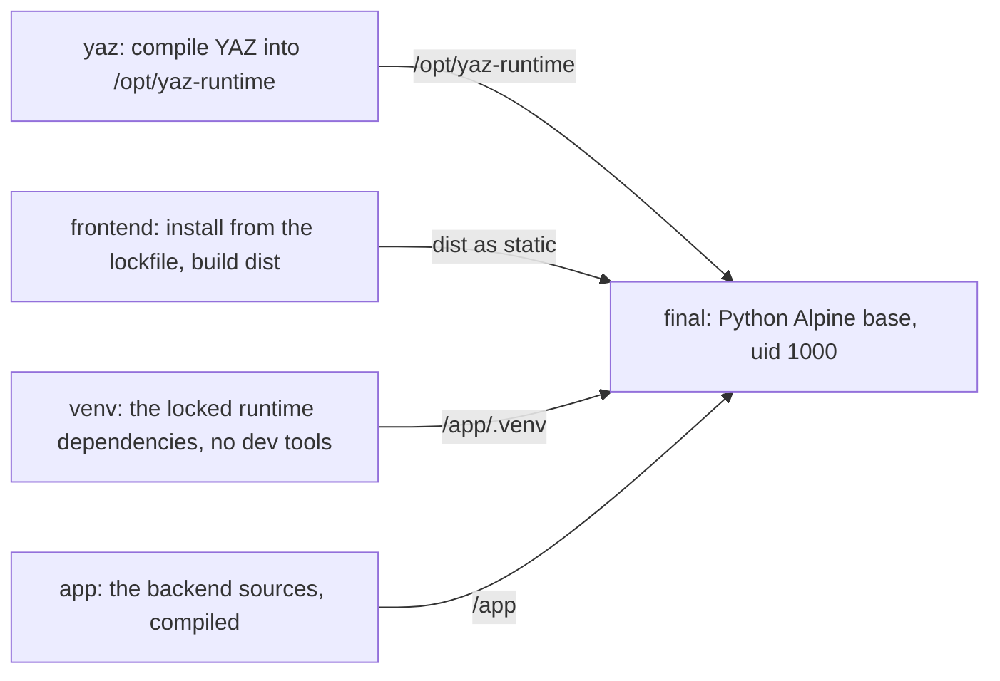

# Architecture

Endpaper ships as one container. Inside it, one FastAPI process serves the JSON API and the
compiled React app from the same port, keeps its data in SQLite or Postgres, and keeps cover
images on disk under `DATA_DIR`. It reaches the internet only when someone asks it to, for
catalogue lookups, covers, OPDS servers, Readwise and an admin's "Send now" digest, and on two
hourly timers, for the overdue digest and the Readwise pull. Beyond those it connects only to
the servers its settings name: a Postgres database, an LDAP directory and a mail server.

Who it is for, what it does and how to install it are in the [README](../README.md); every
setting is in [configuration.md](configuration.md). This page is for changing it. It starts
with two pictures of the whole and then goes deeper one part at a time.

**System context.** What talks to the container, and what it talks to.



The reverse proxy is optional for a LAN install and required for anything exposed: the
container serves plain HTTP. Under proxy sign in it is also what says who the member is.

**Inside the container.** The order things are registered in `main.py` is the order a
request meets them, and the order is load bearing.



## Contents

- [A request, end to end](#a-request-end-to-end)
- [The components](#the-components)
- [Which way imports point](#which-way-imports-point)
- [The privacy rule as a seam](#the-privacy-rule-as-a-seam)
- [The catalogue lookup](#the-catalogue-lookup)
- [Imports and files](#imports-and-files)
- [Identity and sessions](#identity-and-sessions)
- [Startup and migrations](#startup-and-migrations)
- [State and persistence](#state-and-persistence)
- [Outbound work](#outbound-work)
- [Development runs as two processes](#development-runs-as-two-processes)
- [The build and the image](#the-build-and-the-image)
- [Query cost](#query-cost)
- [Error responses](#error-responses)
- [Decisions taken in the code](#decisions-taken-in-the-code)
- [Testing and CI](#testing-and-ci)

## A request, end to end

One member opening one book, `GET /api/books/{book_id}`, passes every layer a request can
pass.



**A book the member may not see answers exactly as a book that does not exist**, 404 with
the same detail, because a 403 would confirm that the id is taken. `dependencies._not_found`
holds that rule. A route resolves a book id through one of the `BookFor...` dependencies,
and each of them starts from a Shelf.

The Starlette middleware order is in `main.py` beside each `add_middleware`: the unhandled
error answer is added first, so it sits innermost and answers a route's exception before the
server sees it, and the body size limit sits just outside it so a refusal still carries the
security headers.

## The components

The backend is flat modules under `backend/`, plus `routers/` and the `schemas/` package. A module is named for the one question it answers, and its docstring says
which. The layers group them:

| Layer | What it holds |
|---|---|
| App | `main.py` builds the app object; `middleware.py`; `recover.py`, the one command line entry point |
| Routers | one module per area of the API. A router declares routes and their refusals, resolves the caller and the book, and calls down. It holds no query over many Books |
| Request support | `dependencies.py` (who is asking, which book, pagination) and `serialisation.py` (rows to payloads) |
| Identity | accounts, sessions and the three sign in backends |
| Protocols and notifications | what speaks a protocol other than this API: the SRU server, KOReader sync, the OPDS and Readwise readers, the overdue digest and mail |
| Imports and files | applying a parsed export, reading one service's export, backup and restore, and the covers directory |
| Domain | the rules about Books, Members and their records: the Shelf, reading status, lending, merging two Books, tags, categories, classifications, custom fields, highlights |
| Settings | runtime settings and sealed catalogue logins |
| Catalogue | asking outside catalogues: targets as data, the order, the fetch, the decoders and the record type |
| Contracts | `schemas/`, the request and response models, one module per domain |
| Foundations | configuration, the database, migrations, the models, errors, rate limits, closed value sets, and pure rules with no database such as ISBNs and Dewey numbers |

The frontend follows one shape per page. `src/app/` is the shell: routing, providers, the top
bar. `src/pages/<Page>/` holds `index.ts`, the page, its `hooks.ts`, its types and its own
components. **Only a page's `hooks.ts` calls the API**, through the client in
`src/api/generated/`, which is generated from the backend's OpenAPI schema and committed.
`src/components/` holds general components that know nothing about books, `src/lib/` pure
helpers with no React, and `src/i18n/` the English catalogue and its German translation.
[frontend.md](frontend.md) is the long version.

The pages, read from `src/pages/`:

<!-- pages: begin -->
- [`AppearancePage`](../frontend/src/pages/AppearancePage)
- [`AuthorsPage`](../frontend/src/pages/AuthorsPage)
- [`BookDetail`](../frontend/src/pages/BookDetail)
- [`CollectionsPage`](../frontend/src/pages/CollectionsPage)
- [`DuplicatesPage`](../frontend/src/pages/DuplicatesPage)
- [`Home`](../frontend/src/pages/Home)
- [`LoansPage`](../frontend/src/pages/LoansPage)
- [`LoginPage`](../frontend/src/pages/LoginPage)
- [`OverduePage`](../frontend/src/pages/OverduePage)
- [`PublicCataloguePage`](../frontend/src/pages/PublicCataloguePage)
- [`QuotesPage`](../frontend/src/pages/QuotesPage)
- [`ScanPage`](../frontend/src/pages/ScanPage)
- [`SeriesPage`](../frontend/src/pages/SeriesPage)
- [`SettingsPage`](../frontend/src/pages/SettingsPage)
- [`StatsPage`](../frontend/src/pages/StatsPage)
- [`TrashPage`](../frontend/src/pages/TrashPage)
- [`errors`](../frontend/src/pages/errors)
<!-- pages: end -->

### Every backend module

Generated from each module's docstring, its first paragraph. A module added without a row
here fails the test suite on the push that adds it; a row that no longer matches its
docstring is refused when a release is tagged. `migrations/`, `scripts/` and `tests/` are not
listed.

<!-- inventory: begin -->
| Layer | Module | What it is |
|---|---|---|
| App | [`main.py`](../backend/main.py) | The FastAPI application: startup and seeding, the middleware and routers it mounts, the health check, and the frontend it serves. |
| App | [`middleware.py`](../backend/middleware.py) | Response headers that constrain what a browser will do with our pages. |
| App | [`recover.py`](../backend/recover.py) | Set a password from the container's command line. |
| Routers | [`routers/auth.py`](../backend/routers/auth.py) | Signing in and out, registration, password resets, address verification and switching accounts. |
| Routers | [`routers/backup.py`](../backend/routers/backup.py) | Downloading the whole catalogue, and putting one back. |
| Routers | [`routers/books.py`](../backend/routers/books.py) | The book routes: listing, adding and editing, the trash, merging duplicates, lookup and search, exports, tags, custom fields, notes, series and authors. |
| Routers | [`routers/collections.py`](../backend/routers/collections.py) | Named parts of the shelf: physical and ebook, kept and sold, yours and mine. |
| Routers | [`routers/covers.py`](../backend/routers/covers.py) | Uploaded cover images, served only to members allowed to see the book. |
| Routers | [`routers/imports.py`](../backend/routers/imports.py) | Bulk import from other services. |
| Routers | [`routers/kosync.py`](../backend/routers/kosync.py) | KOReader's progress sync: the device protocol, and the member's screens for it. |
| Routers | [`routers/loans.py`](../backend/routers/loans.py) | Lending: lending a book, returning it, and the overdue lists and reminders. |
| Routers | [`routers/opds.py`](../backend/routers/opds.py) | The household's own OPDS servers: configuring them, and syncing what they hold. |
| Routers | [`routers/public.py`](../backend/routers/public.py) | The catalogue as a reader with no account sees it. |
| Routers | [`routers/readwise.py`](../backend/routers/readwise.py) | A member's Readwise token and their pull, behind the ordinary session. |
| Routers | [`routers/settings.py`](../backend/routers/settings.py) | *No module docstring.* |
| Routers | [`routers/sru.py`](../backend/routers/sru.py) | The SRU base URL: one route, and everything it has to pass first. |
| Routers | [`routers/stats.py`](../backend/routers/stats.py) | A member's reading statistics, over the books that member can see. |
| Routers | [`routers/users.py`](../backend/routers/users.py) | Members: the list, test accounts, each member's appearance, email and security, and the admin's reset and verification queues. |
| Request support | [`dependencies.py`](../backend/dependencies.py) | Reusable request dependencies: book access control, pagination, and the NUL refusal every published route takes. |
| Request support | [`serialisation.py`](../backend/serialisation.py) | Turning ORM rows into the payloads the API returns. |
| Identity | [`accounts.py`](../backend/accounts.py) | The account lifecycle: proving an address, and getting back in. |
| Identity | [`auth.py`](../backend/auth.py) | Passwords and tokens: hashing, the session and cover tokens, and the dependencies that resolve the signed in member. |
| Identity | [`auth_backends.py`](../backend/auth_backends.py) | Where "who is this?" gets answered. |
| Protocols and notifications | [`kosync.py`](../backend/kosync.py) | KOReader's progress sync, served from this library. |
| Protocols and notifications | [`mailer.py`](../backend/mailer.py) | Sending one mail, over SMTP, with the refusals that belong to that transport. |
| Protocols and notifications | [`notifications.py`](../backend/notifications.py) | Chasing overdue loans, by sending one digest on every channel that is on. |
| Protocols and notifications | [`opds.py`](../backend/opds.py) | One reader for the self hosted OPDS servers, and it runs here rather than in the browser. |
| Protocols and notifications | [`readwise.py`](../backend/readwise.py) | Pulling a member's Readwise highlights into `highlights`, and nothing back. |
| Protocols and notifications | [`sru.py`](../backend/sru.py) | SRU, served rather than consumed, which is the other direction from `targets.py`. |
| Imports and files | [`backup.py`](../backend/backup.py) | Taking the whole catalogue out, and putting it back. |
| Imports and files | [`cover_store.py`](../backend/cover_store.py) | The covers directory, and the only door into it. |
| Imports and files | [`csv_import.py`](../backend/csv_import.py) | Reading a library export from any of the services people leave. |
| Imports and files | [`import_readers.py`](../backend/import_readers.py) | What an import reader is, and it is never told how the file arrived. |
| Imports and files | [`importing.py`](../backend/importing.py) | Applying a parsed export to a Library: the half of importing that writes. |
| Imports and files | [`uploads.py`](../backend/uploads.py) | Validation for uploaded images, and the two ways bytes reach a file. |
| Domain | [`authorship.py`](../backend/authorship.py) | Who wrote what: the half of author identity that touches the database. |
| Domain | [`book_columns.py`](../backend/book_columns.py) | What each column of `books` is about, for every writer that needs a set of them. |
| Domain | [`catalogue_access.py`](../backend/catalogue_access.py) | Whether this Library may ask an outside catalogue, and what a Member is told if not. |
| Domain | [`classifications.py`](../backend/classifications.py) | The classifications table: what may be written to it, and how much. |
| Domain | [`custom_fields.py`](../backend/custom_fields.py) | The facts a Library keeps about its Books that this schema does not know. |
| Domain | [`disclosure.py`](../backend/disclosure.py) | Who may be told a Library wide vocabulary entry exists, for any vocabulary. |
| Domain | [`evidence.py`](../backend/evidence.py) | Applying outside evidence to a Book that already exists, under a named policy. |
| Domain | [`fields.py`](../backend/fields.py) | Which of the Library's own fields one Member may be told exist, and which they may name by id. |
| Domain | [`file_references.py`](../backend/file_references.py) | What one look at a file may write to its reference, and which Books hold a file. |
| Domain | [`folding.py`](../backend/folding.py) | What becomes of everything pointing at a Book when two Books turn out to be one. |
| Domain | [`highlights.py`](../backend/highlights.py) | The highlight ledger: what every source's import does once it has a key. |
| Domain | [`identifiers.py`](../backend/identifiers.py) | The `book_identifiers` table: what may be written to it, and how much. |
| Domain | [`koreader_highlights.py`](../backend/koreader_highlights.py) | A KOReader sidecar's highlights as the ledger's marks: how each is keyed. |
| Domain | [`lending.py`](../backend/lending.py) | The lending desk: which Loans a reader may see, when one closes, and what a Loan is at a given moment. |
| Domain | [`reading.py`](../backend/reading.py) | One Member's reading of the Books in this Library, and the only place a `user_books` row is read or written. |
| Domain | [`recognition.py`](../backend/recognition.py) | Which existing Book a record is, as one Member sees it. |
| Domain | [`shelf.py`](../backend/shelf.py) | Every query that returns or counts many Books, and the only place the privacy predicate is applied. |
| Domain | [`shelving.py`](../backend/shelving.py) | Which named parts of the shelf one Member may be told exist, and which they may file a Book into. |
| Domain | [`tags.py`](../backend/tags.py) | Deciding a tag from a name, how many one Book may carry, and who may be told one exists. |
| Settings | [`credentials.py`](../backend/credentials.py) | A login at somebody else's catalogue: sealed at rest, bound to one origin. |
| Settings | [`settings_store.py`](../backend/settings_store.py) | Admin-editable settings that survive a restart. |
| Catalogue | [`authority.py`](../backend/authority.py) | The authority files, read for a person rather than for a book. |
| Catalogue | [`bibliographic.py`](../backend/bibliographic.py) | What a bibliographic value means, whatever serialisation carried it. |
| Catalogue | [`catalogue.py`](../backend/catalogue.py) | What an outside catalogue asserted about one book, as a type rather than a dict. |
| Catalogue | [`covers.py`](../backend/covers.py) | Finding a cover that actually exists. |
| Catalogue | [`decoders.py`](../backend/decoders.py) | What a decoder is, and it is never told how the bytes arrived. |
| Catalogue | [`fetch.py`](../backend/fetch.py) | One door for the catalogue requests this app makes, and every bound on them. |
| Catalogue | [`google_books.py`](../backend/google_books.py) | Metadata enrichment from the Google Books API. |
| Catalogue | [`marc.py`](../backend/marc.py) | MARC21 records in and out, as pure functions over bytes. |
| Catalogue | [`marc_fields.py`](../backend/marc_fields.py) | How MARC21 spells a bibliographic value, and nothing about where it came from. |
| Catalogue | [`metadata.py`](../backend/metadata.py) | Turning a scanned ISBN into a book, across several catalogues. |
| Catalogue | [`sources.py`](../backend/sources.py) | Which catalogues are asked about a book, and in what order. |
| Catalogue | [`targets.py`](../backend/targets.py) | One catalogue target as data: where it is, how it is asked, what reads it back. |
| Catalogue | [`xml_parse.py`](../backend/xml_parse.py) | What turning a stranger's XML into a tree may cost, and the one builder that holds it. |
| Catalogue | [`z3950.py`](../backend/z3950.py) | One door for the Z39.50 requests this app makes, and every bound on them. |
| Catalogue | [`z3950_provisional.py`](../backend/z3950_provisional.py) | **PROVISIONAL.** The one Z39.50 client that exists today, and not the chosen one. |
| Contracts | [`schemas/`](../backend/schemas/) | Request and response contracts. |
| Foundations | [`authors.py`](../backend/authors.py) | Who wrote what, read out of one free text column. |
| Foundations | [`categories.py`](../backend/categories.py) | A Book's Categories: the stored form of `books.categories`, its bounds, and the four producer policies. |
| Foundations | [`config.py`](../backend/config.py) | Runtime configuration, resolved from the environment. |
| Foundations | [`database.py`](../backend/database.py) | The engine and the session: connection settings for SQLite and Postgres, per connection setup, and commit and rollback hooks. |
| Foundations | [`ddc.py`](../backend/ddc.py) | The Dewey Decimal Classification, and how a library reads one. |
| Foundations | [`deadline.py`](../backend/deadline.py) | What a deadline is, and the two questions every holder of one asks. |
| Foundations | [`dialect.py`](../backend/dialect.py) | What a rule written in one engine's own SQL IS, once there are two engines. |
| Foundations | [`downloads.py`](../backend/downloads.py) | What makes a response a download rather than a page. |
| Foundations | [`enums.py`](../backend/enums.py) | Closed value sets shared by the ORM, the schemas and the query parameters. |
| Foundations | [`errors.py`](../backend/errors.py) | Error responses, in whichever form the caller can use. |
| Foundations | [`filing.py`](../backend/filing.py) | How a classification scheme's call numbers sort. |
| Foundations | [`identity.py`](../backend/identity.py) | What makes two books the same book. |
| Foundations | [`isbn.py`](../backend/isbn.py) | Parsing, validation and canonicalisation of ISBNs. |
| Foundations | [`logvalues.py`](../backend/logvalues.py) | How much of an untrusted value reaches a log line. |
| Foundations | [`models.py`](../backend/models.py) | The ORM: every table as a SQLAlchemy model, with the constraints the database holds. |
| Foundations | [`ratelimit.py`](../backend/ratelimit.py) | Rate limiting for the credential endpoints, bulk import and metadata lookups. |
| Foundations | [`refusals.py`](../backend/refusals.py) | The refusals a route declares in the schema, read off what the route runs. |
| Foundations | [`schema.py`](../backend/schema.py) | Bringing the database up to date at startup. |
<!-- inventory: end -->

## Which way imports point

A layer imports from the layers beneath it. A solid arrow joins each layer to the next one
down. **A dashed arrow is an import that points up**, labelled with how many pairs of modules
make it, and the table under the diagram names each pair: read it before moving either end of
one. Generated from the import statements, function local imports included.

<!-- layers: begin -->


| Module | Imports, up the stack |
|---|---|
| `backup.py` | `main.py` |
| `catalogue.py` | `custom_fields.py` |
| `covers.py` | `cover_store.py` |
| `covers.py` | `uploads.py` |
| `lending.py` | `notifications.py` |
| `models.py` | `covers.py` |
| `refusals.py` | `schemas/` |
| `schemas/` | `bibliographic.py` |
| `schemas/` | `covers.py` |
| `schemas/` | `import_readers.py` |
| `schemas/` | `mailer.py` |
<!-- layers: end -->

## The privacy rule as a seam

A Book is either public in the Library or private to the Member who added it, and a private
Book must never reach anyone else: not in a list, a count, a search, an export, a statistic or
a cover. [data-model.md](data-model.md) states the rule and [security.md](security.md) the
threat. This is where it lives in the code.



**`backend/shelf.py` is how the application queries many Books, with two exceptions.** The
backup archive reads every row, because a backup missing other members' private Books would
restore a library short of rows, and only an admin can take one. The overdue digest has no
viewer, and leaves private Books out of every channel it pushes to, by a clause of its own. The
allowlists in [`backend/tests/test_shelf.py`](../backend/tests/test_shelf.py) name every module
that reads Books past the Shelf, each with its reason.

The Shelf's three class methods are its only constructors, and each applies its predicate
before a caller can narrow anything. A caller narrows a Shelf with `where` and `matching`, and
every narrowing returns a new Shelf, so the predicate cannot be dropped on the way.

**One Book goes through the same door.** `book_for_read`, `book_for_write`, `book_for_owner`,
`book_in_trash` and `book_for_cover` in `dependencies.py` each start from a Shelf, and each
answers 404 for a Book the caller may not see.

**Covers are a router, not a static mount**, for this reason. A mount has no dependencies, so
nothing would authenticate it, and a cover's file name is its Book's id: any member could read
another member's private cover by counting. The cover route resolves the Book through
`book_for_cover`, which accepts a path scoped cookie as well as the header because an ``
cannot send one.

**The public catalogue has no ownership arm at all.** `Shelf.seen_by_the_public` is
`visible_to` with its second clause removed rather than called with a sentinel id, so no input
can make a private Book match.

## The catalogue lookup

Scanning or typing an ISBN calls `metadata.lookup`. A **target** is one catalogue described as
data in `targets.SEEDED`: where it is, which transport reaches it, which decoder reads its
records, whether it answers an ISBN lookup, a title search or both, and which ISBN groups it
covers. `sources.py` holds the order and what each tier means. Adding a catalogue is a row and,
at most, a decoder.

The default plan, generated from those two modules. A library may reorder it and switch
sources off in its settings.

<!-- roster: begin -->

<!-- roster: end -->

1. **The ISBN is canonicalised**, and input that cannot be one costs no request. A cached
   answer returns at once.
2. **The leading pair is asked together** and their records merged by `metadata._merge`. This
   is where record quality comes from. A metered source is never in the pair, so an ordinary
   lookup spends no quota unless a library moves it up and switches the pair off. Who is
   believed about a field is `_preferred_source` and `_MATCH_PRECEDENCE`, not the order.
3. **The rest are asked one at a time** until one finds the book. A source with a remit is
   skipped for an ISBN outside it.
4. **Each request goes through `fetch.py`**, which bounds it by deadline, body size and
   redirects, and a decoder in `decoders.py` turns the answer into a `catalogue.Record`. The
   decoder is never told how the bytes arrived.
5. **A found record gets a cover** from `covers.resolve`, which checks that the image exists
   before offering it.

A title search is a different path, `metadata.title_search`: it asks every search source the
plan allows within a deadline, ranks the matches by `_relevance`, and offers a slower "search
harder" with a longer one.

`z3950.py` is the bounded door for Z39.50 and `z3950_provisional.py` the client behind it.
No seeded target uses that transport yet, and `targets.Target` refuses one until the dispatch
exists, so no lookup reaches the library the image carries.

## Imports and files

**A member's book files never reach the server.** The browser reads them: EPUB, PDF, MOBI,
FB2, CBZ, audiobooks, a Calibre library folder, device databases and cloud exports, each
parsed by a reader in `src/lib/`. What crosses is the metadata and a fingerprint of the file
(`schemas/digital.py`), which the server treats as untrusted input like any catalogue record.
An export file from another service is different: it is a list of books rather than a book,
and the server parses it.



**Recognition is one question asked by every door**: given a title, an author and
identifiers, which existing Book is this, as this Member sees it. `recognition.Index` answers
it per source kind with its own key ladder, and is built once per import, so a file of
thousands of rows costs no query per row. The Readwise pull uses the same index, and adding
one Book asks `recognition.recognise_one` instead.

**The OPDS reader is the one parser that runs on the server**, because a self hosted OPDS
server rarely sends the headers a browser needs to read it, and an OPDS feed is a catalogue
rather than a file. `opds.py` says why at length.

## Identity and sessions

`AUTH_MODE` picks one of three backends in `auth_backends.py`. It is an environment
variable, so a deployment chooses without a code change, and `local` is the default.
[configuration.md](configuration.md) has the settings for each.

| Mode | Where identities live | The login screen |
|---|---|---|
| `local` | This app's `users` table | Shown |
| `ldap` | A directory; accounts are provisioned there | Shown, credentials are checked against the directory |
| `proxy` | Whatever the upstream proxy asserts in headers | **Not shown** |



`ldap` binds twice: a service account searches for the user, then the app rebinds as that
user to verify the password. It upserts a local row so books, notes and loans still have
something to point at, and re-applies group membership on every sign in, so revoking admin in
the directory takes effect at the next login rather than never.

`proxy` is the mode with a sharp edge. It trusts request headers, which is safe only behind a
proxy that sets them and strips incoming ones. The frontend knows which mode is running and
drops its login form entirely under `proxy`.

**An admin may switch into a test account** with that account's password, through
`POST /auth/switch`. Under proxy sign in the switch token beats the header, but only while the
account it names is still a test account (`models.is_switch_target`), so no token can override
the proxy's identity for a real member.

## Startup and migrations

`main.py` runs `init_db()` at import, before the app object exists, then registers the
middleware and the routers, checks them, and mounts the frontend. The tickers start with the
app's lifespan.



1. `validate_secret_key()`: **refuse to boot** outside `APP_ENV=dev` if `SECRET_KEY` is a
   shipped placeholder or shorter than 32 bytes. With the example key every session token is
   forgeable by anyone who has read the repository. The alternative to failing loudly is an
   app that looks healthy while being impersonable.
2. `validate_auth_config()`: **refuse to boot** on an auth setup that would silently
   misbehave, mainly an `LDAP_BIND_DN` with no bind password. See [security.md](security.md).
3. `ensure_data_dirs()`: create `DATA_DIR/covers` if missing.
4. `upgrade_to_head()`: create or migrate the database with Alembic (see below).
5. `seed_tags()`: insert any predefined tag that is missing.
6. `seed_catalogue_targets()`: write the catalogue roster `targets.SEEDED` holds, updating
   any row whose constants have moved.

Steps 3 to 6 are idempotent, so a restart is always safe and a fresh volume
self-initialises. There is no bootstrap command.

`assert_unique_operation_ids()` runs after the last router is registered and fails startup if
two handlers share a name. [decisions.md](decisions.md) covers why that matters, and how its
first version managed to check nothing.

### Migrations

Schema changes go through **Alembic** (`backend/migrations/`), run automatically at startup
by `backend/schema.py`. **Nothing in the application calls `create_all()`**, and `main.init_db`
says why at the call: two things that both create tables is how a database ends up in a shape
no migration accounts for. So a new table needs a revision exactly as much as a new column
does.

`schema.upgrade_to()` handles three cases, and the middle one is the awkward part:

| The database is | What happens |
|---|---|
| Empty | Every revision runs; the baseline creates the tables |
| Pre-Alembic (real tables, no `alembic_version`) | **Apply the two legacy fixups, stamp the baseline, then upgrade.** Running the baseline would try to create tables that already exist |
| Already managed | Upgrade to head |

Two details that cost time to find:

- **`render_as_batch=True`.** SQLite cannot `ALTER TABLE` to add or change a constraint;
  batch mode rebuilds the table instead. Without it most non-trivial migrations fail on
  SQLite, which is the default engine and the one every revision has to run on.
- **Alembic's `fileConfig()` replaces process-wide logging.** Running a migration in-process
  at startup silently reconfigured the application's own loggers. `env.py` honours a
  `configure_logger` attribute so the app can suppress it. The symptom was a `caplog`
  assertion going quiet, not an error.

The unique index on `user_books (user_id, book_id)` deduplicates existing rows first.
Nothing prevented duplicates before, so creating it would otherwise fail on any real
database. It is an *index* rather than a constraint for the batch-mode reason above.

## State and persistence

Everything mutable lives under `DATA_DIR`, unless `DATABASE_URL` names a Postgres server:

```
$DATA_DIR/
├── library.db          SQLite: every table, unless DATABASE_URL points elsewhere
└── covers/
    ├── 12.jpg          uploaded cover, named by book id
    └── login_bg.png    the admin-set login background
```

**SQLite is the default and Postgres is the one other engine**, reached through the pg8000
driver. The application code is the same for both. Where the two engines need different SQL,
for a CHECK constraint or a date bucket, `dialect.py` and `database.py` keep both spellings
side by side and refuse a third engine rather than guessing. How to choose and configure one,
TLS to Postgres included, is in [configuration.md](configuration.md).

With SQLite, backing up means copying that directory. There is no cache and no external
service to keep in step. With Postgres the database is backed up on its own, beside the
covers.

Cover files are named by book id, so a book has at most one uploaded cover and re-uploading
replaces it. The handler deletes any existing file with a different extension first, or
`12.jpg` and `12.png` could both exist and which one won would depend on lookup order.

SQLite is a fit here rather than a stopgap: a handful of members making occasional writes.
`check_same_thread` is disabled, because FastAPI runs synchronous endpoints in a worker thread
pool, so the session is created on one thread and used on another.

### Runtime settings

Some things are configured by an admin in the app rather than by an environment variable
and a restart: the Google Books toggle and API key, the Goodreads lookup toggle, the reminder
channels, and the default language. They live in a `settings` table behind
`backend/settings_store.py`.

The split is deliberate. **Environment** holds what a deployment decides and what must be
right before the app can serve a request: the secret key, the auth mode, the data directory.
**The settings table** holds what a library decides and may change on a Tuesday.

`GET /api/settings/features` exposes only the flags, publicly, because the login page is
localised and needs the default language before anyone has a token. The full record,
including the masked API key, is admin-only.

`GET /api/settings/features` sends `google_books_ready`, which is whether Google Books will
actually work: the admin's toggle is on **and** a key exists. The UI needs it to decide
between offering a control and greying it out, because a toggle with no key behind it
produces a button that can only ever 400. It does not reveal the key.

**The raw toggle is not sent beside it**, and lives on the admin record instead: sent
together the two say more than the conjunction alone does. The rule that came out of it,
every field on this endpoint has a reader and one with none is refused, is stated on
`FeatureFlagsOut` with the argument, and held by a test on each side.

**The key has two possible homes, and the environment wins.** `GOOGLE_BOOKS_API_KEY` in the
environment overrides anything stored, cannot be edited through the app, and causes a write
attempt to be **refused rather than ignored**: silently accepting a value that does nothing
would leave an admin believing they had changed the key. The stored value is left in place
rather than deleted, so unsetting the variable restores it.
`settings_store.google_books_api_key()` is the single place that resolves the precedence.

### Sealed logins

**A login at somebody else's catalogue is not one of the app's own secrets**, so it does not
live in `settings`, whose four secrets are sealed under their own names. `credentials.py`
seals each login at rest, bound to its kind, its subject and the origin it is for, so a
ciphertext moved to another row or another address fails to open rather than being sent there.
The key comes from the deployment and is never a default.

## Outbound work

Three things leave the container without a member waiting on the answer.

| Work | Started by | Module | What leaves |
|---|---|---|---|
| The overdue digest | a ticker, hourly, and an admin's "Send now" | `notifications.py` | one digest per enabled channel: mail, Telegram, a webhook. Private Books are left out of every channel that pushes |
| The Readwise pull | a ticker, hourly, pulling each member at most daily | `readwise.py` | the member's own token and Readwise's own cursor. No passage, note or Book goes back |
| Cover fetch | adding a Book, a lookup, or a member's cover backfill | `covers.py` | a request to the image hosts `covers.py` names, checked before a cover is stored |

**Both tickers assume one process.** The image starts one uvicorn with no `--workers`, so
there is exactly one of each. Several workers would race on the same rows; a deployment
that needs them switches a ticker off (`ENABLE_OVERDUE_TICKER=false`) and calls
`POST /api/loans/overdue/notify` from outside instead.

## Development runs as two processes

```
        bun run dev                        uv run uvicorn
   ┌──────────────────────┐          ┌───────────────────────┐
   │ Vite dev server      │  proxy   │ FastAPI               │
   │ :5173                │─────────►│ :8000                 │
   │ HMR, React Refresh   │          │ /api /auth /covers    │
   └──────────────────────┘          └───────────────────────┘
```

`vite.config.ts` proxies `/api`, `/auth` and `/covers` to `localhost:8000`, so the frontend
uses the same relative URLs in both environments. The generated client emits origin-relative
paths and `src/api/mutator.ts` adds no base URL, so there is no `VITE_API_URL` to get wrong.

`bun run api:generate` regenerates that client from the backend's schema. The output is
committed, so neither the build nor the test suite needs a Python toolchain.

## The build and the image

`/covers` is a router rather than a static mount, the SPA is mounted last, and an unmatched
path is answered with the shell only when it is a navigation: what the running image serves
is this table.

| Path prefix | Served by | Notes |
|---|---|---|
| `/api/*`, `/auth/*` | FastAPI routers | The JSON API |
| unmatched `/api/*`, `/auth/*` | a fallback router | JSON 404, see below |
| `/covers/*` | a FastAPI router | Uploaded cover images, from `DATA_DIR/covers` |
| `/api/healthz` | a FastAPI route | Liveness and readiness. Runs a query **and** stats the data directory under its own timeout |
| `/kosync/*` | a FastAPI router | KOReader's progress sync protocol |
| `/sru` | a FastAPI route | The SRU server, behind the public catalogue's gate |
| everything else | `StaticFiles(html=True)` | The compiled React bundle |

**`SERVE_FRONTEND=false` skips that mount**, leaving the API on its own. The shipped image
always contains `static/`, so absence never happens in production and this is the only way
to ask for it. It is one flag on one image rather than a second image: the compiled files
sit on disk unused. With it set, the whole last row of the table above is gone and an
unmatched path is a plain 404 rather than the shell. That is correct rather than a
regression: the fallback below exists so a *client route* survives a refresh, and a host
serving no frontend has no client routes.

**`html=True` alone does not make it a catch-all**, and believing it did was a real bug:
Starlette serves `index.html` for `/` and for a directory, and answers anything else 404.
Measured in the running container, with a valid session, `/book/12`, `/settings` and
`/quotes` were all 404, so a bookmark, a refresh anywhere but home, and a shared link to a
book were all broken. `CachePolicyStaticFiles.get_response` is what actually serves the
shell for an unmatched path, under three conditions: not an API path, a request that
accepts `text/html` (a navigation, not a `fetch`), and not under `assets/`. The last two
are why a missing hashed chunk still fails cleanly as a 404 instead of arriving as HTML
inside a script tag.

The covers router is registered before the mount, or cover requests would be answered with
the shell.

Between the routers and the mount sits a fallback matching `/api/{rest:path}` and
`/auth/{rest:path}`, returning a JSON 404. Its job is the **body**, not the status: without
it an unknown API path reaches the SPA mount, which refuses it the shell (`wants_html`
excludes API prefixes) and 404s, but a `fetch()` would then get this app's HTML error page
rather than the JSON every other failure returns. It is also the first of the two guards
that stop an API typo becoming a 200 with HTML in it, which is what it was written for.

Serving the API and the bundle from one origin means the browser never makes a cross-origin
request in production, which is why CORS is **off** by default. Vite proxies rather than
making cross-origin calls, so dev does not need it either. Set `CORS_ORIGINS` only for a
genuinely separate frontend host.

### The stages



Only the compiled assets cross from the frontend stage, so Bun, `node_modules` and the
TypeScript sources are absent from the shipped image. Only the virtualenv crosses from the
venv stage, so uv is absent too.

Both install stages read a lockfile (`bun.lock`, `uv.lock`) and every base image the
Dockerfile names is pinned by digest, so rebuilding a commit produces the same dependency
set. The runtime dependencies exclude pytest, ruff and mypy, and the image runs as **uid
1000, non-root**. The data directory is that user's. The code and the virtualenv are
root's, compiled at build time, readable by everyone and writable only by root.

Every stage is Alpine, which sets a bar for new Python dependencies. A C-extension package
with no musllinux wheel does not fail politely: uv tries to build it from source and dies
for want of a compiler, in CI, at image-build time.

### The Z39.50 client library

The first stage compiles **YAZ**, IndexData's Z39.50 implementation, because national library
catalogues speak Z39.50 and nothing else reaches several of them. Six of the eight targets
surveyed run YAZ as their server.

**What uses it.** `backend/z3950.py` is the transport and `backend/z3950_provisional.py`
is the client behind its seam, binding `libyaz.so.5` through `ctypes`. The client is
explicitly provisional: the route was not settled when the transport was written, and the
seam exists so that changing it is a change to one function. No seeded target uses the
transport yet ([The catalogue lookup](#the-catalogue-lookup)).

**Alpine packages no YAZ.** Checked across edge, v3.22, v3.21 and the pinned base's own
3.24.1, in main, community and testing: no `yaz`, no `yaz-dev`. So it is either compiled or
the base image changes, and the base image is the expensive half: `python:3.14.7-slim` is
41.4 MB compressed against alpine's 16.9 MB, so moving to Debian for a packaged `libyaz5`
costs 24.5 MB before YAZ is installed at all, and buys a larger scan surface against a
release gate that refuses a fixable HIGH. Compiling costs about a minute, once.

It compiles clean against musl with no patches, which is a narrower claim than it sounds:
configure and make complete, which is not the same as the sources being musl-correct.
Upstream 5.36.0 carries a fix, "expose gethostbyaddr with `_GNU_SOURCE`", that a clean
build would not have revealed.

What the runtime image pays, measured on the pinned base with `du -sk /` before and after,
Alpine 3.24.1, package count 30 to 32 to 40:

| | |
|---|---|
| `libxml2` and `libxslt` | 1,384 KiB |
| `gnutls`, plus nettle, gmp, p11-kit, libtasn1, libunistring, brotli-libs and libidn2 | 7,704 KiB |
| `/opt/yaz` itself, stripped: `libyaz.so.5` and `yaz-client` | 1,844 KiB |
| | **10,932 KiB** |

`gnutls` and the seven packages behind it are **70% of that**, 85% of the package cost
alone, and buy Z39.50 over TLS, which no surveyed target uses: every one answers plaintext.
Removing them is two edits rather than one, `./configure --without-gnutls` and dropping
`gnutls` from the runtime package line, and it is a capability decision rather than a build
tidy-up.

**The size is not the cost. The advisory stream is.** The three libraries and everything
they pull in carry **94 distinct CVE ids** in Alpine's security database: 52 against the
gnutls group, of which gnutls alone accounts for 36, and 42 against libxml2 and libxslt.
Counted at two scopes, v3.24 main alone and v3.24 with v3.21 and v3.19 across main and
community, which agree. They land on the scan that blocks a release, which refuses a
fixable HIGH or CRITICAL, so each one is a release held until the base image carries the
fix.

**All three are equally optional to the build**: YAZ offers `--with-xml2` and `--with-xslt`
beside `--with-gnutls`, and a build without any of them links none of them. So the 52 is
the price of TLS only against a judgement, not against a build constraint. The judgement is
about record handling: the catalogue records this application exists to read are parsed and
converted through libxml2 and libxslt, so dropping those would cost a feature, while
dropping gnutls would cost an encrypted transport that no surveyed target offers. That is
the argument for treating the 52 as separable and the 42 as not, and it is a claim about
what this application needs rather than about what YAZ requires.

**Nothing watches the library itself.** `/opt/yaz/lib/libyaz.so.5` is compiled here rather
than installed from a package, so no package database lists it and the image scanners
enumerate nothing for it: they read package manifests and lockfiles, and a C library built
from a tarball appears in neither. A YAZ advisory reaches this repository only through the
dependency bot watching upstream's release tags, and the version and its hash are then
bumped by hand together.

**What that TLS is worth is worth knowing.** YAZ verifies the peer's certificate only
when asked: the ZOOM option `check_cert` arrived in 5.38.0, defaults to off, and this
application does not set it. An `ssl:` target is therefore encrypted against a passive
listener and not authenticated against anyone able to answer for the address.

**The install prefix is load bearing.** libtool records `/opt/yaz/lib` as `yaz-client`'s
RUNPATH, which is why the binary resolves its library with no `LD_LIBRARY_PATH` and no
symlink into `/usr/lib`, and why the tree has to land at exactly that path. A Python client
should load the library by absolute path for the same reason.

#### The compile does not run on every build

`docker/build-yaz.sh` stamps the tree it produces with a **build id** naming the three
things that decide what gets built: the version, the sha256 of the tarball, and the sha256
of the recipe itself. Handed a tree already carrying that id it does nothing; handed
anything else it compiles. So the build stage can take a prebuilt image as its base and an
ordinary build becomes a layer fetch.

**The id deliberately names nothing about the environment**, and that is the second
attempt. It briefly carried the musl version, so the runtime stage could refuse a library
built against a different libc. That was wrong in three ways at once. The value had to be
read before the compiler was installed, and installing it can move musl, because
`musl-dev` depends on an exact musl version. It said nothing about libxml2, libxslt or
gnutls, which libyaz also links. And it was **too strict**: measured, a YAZ compiled on
Alpine 3.24.1 against `musl-1.2.6-r2` loads and runs clean on Alpine 3.21.7 against
`musl-1.2.5-r11`, three Alpine releases apart, with `LD_BIND_NOW` set so nothing is
deferred to first call.

**That is one ordered pair, and which pair it is matters.** It runs a newly built binary
against an older libc, which is the harder direction, since symbols a new build expects
need not exist in an old library. The scenario the musl term was for is the other way
round, an older binary on a newer libc, so this result covers that case a fortiori.

So, at the strength the evidence carries: **on one pair three releases apart, in the harder
direction, a base image bump that keeps a YAZ built against the previous musl is not a
breakage.** That is a strong directional result and not a proof about every pair, and the
design does not rest on it either way. Where the ABI is compatible there is nothing to
detect; where it is not, **the load check below detects it**. What the version-and-digest
naming is worth is that the artefact is reproducible and attributable, rather than that it
averts a breakage nobody has yet been able to produce.

So the environment is not compared as a string. **It is checked by running the library**,
in the runtime stage, once its dependencies are installed: the shipped `yaz-client` is
executed and required to report the pinned version. That single line covers musl, all three
shared libraries, and the install prefix, since libtool baked `/opt/yaz/lib` into the binary
as its RUNPATH and a tree copied anywhere else cannot find itself. `LD_BIND_NOW` makes that
the whole `DT_NEEDED` closure rather than one library: everything must load and fully bind,
which is strictly more than the musl version string ever compared. **What it cannot cover is
what is loaded later by `dlopen`**, and gnutls does exactly that with p11-kit at TLS setup
time rather than at load. Moot while nothing here speaks TLS, and worth knowing before
anything does. The release smoke test
runs the same command again on the finished image, which is not duplication: the first
fails the build, in any build including somebody's own `docker build`, and the second
proves it in the artefact about to be published.

The stamp is compared once more in the runtime stage, against the tree it received. In an
ordinary build that cannot fire, because both stages inherit the same pins and copy the
same recipe file, so the two ids are equal by construction. It is a check on where the
`COPY` points, and narrower than that sounds in the safe direction: it does **not** fire
when the `COPY` points at a different subset of the same build, because the recipe writes
the same id into both `/opt/yaz` and `/opt/yaz-runtime`. Copying the full tree instead of
the runtime subset would pass this check and silently ship the headers, the documentation
and the two libraries the subset exists to leave out. It is not the guarantee that the
library works.

All of this is in this repository and in the published image's own Dockerfile. The build
pipeline additionally names its prebuilt image after the same facts so it knows when to
rebuild one, but that is a way of not paying the minute rather than a safety property.

The version and its hash are bumped by hand, together. The hash is **trust on first use**:
IndexData publish no signature and no checksum file beside the release, so it records the
bytes one fetch saw and pins them against a later substitution, which is the threat it can
actually address.

## Query cost

Listing endpoints are paginated and serialise a page in a **constant** number of queries.
`active_loan`, `my_status` and the reading-progress fields are not columns: they are
computed per request and depend on who is asking. The obvious implementation queries for
each of them per book, which is what this used to do, and listing 25 books cost 53 SELECTs
(`1 + 2N`). Each is now fetched once per page instead.

**`serialisation.books_to_out` holds the measured numbers**, and this page deliberately does
not repeat them: the count has been restated wrongly here twice, both times by someone
editing the sentence rather than measuring. The short version is that `GET /api/books` is
flat at 5 and at 25 books, and that a caller which fetches books *without*
`joinedload(Book.added_by)` pays one extra statement per distinct author, because
`BookColumns` reads that relationship.

`_latest_progress` is the one to copy if a new field needs the *newest* row per book rather
than one row per book. It ranks with a window function in a single statement rather than
fetching every row and picking in Python, so a member with a long reading history costs the
same as one with none.

If you add another per-request field it goes on `schemas.book.ViewerFields`, **not on
`BookOut`**, and it is batched the same way in `books_to_out()` rather than reached for
inside the loop. The two are one rule: a field on `ViewerFields` carries no default, so
declaring it and forgetting to write it fails to construct instead of answering 200 with a
plausible wrong value. `tests/routers/test_loans.py` holds exact counts, which is what
catches the batching half.

## Error responses

`errors.py` content-negotiates: a browser navigating to a non-API path gets a styled HTML
page from `templates/error.html`, anything else gets `{"detail": ...}`. A catch-all handler
turns an unhandled exception into a generic 500. The traceback is logged and **never**
returned: it names internal paths and can quote request data back to whoever triggered it.

The handlers are registered against **Starlette's** `HTTPException`, not FastAPI's subclass.
Routing failures (an unmatched path, a method not allowed) are raised by Starlette itself as
the base class, so a handler bound only to the subclass never sees them and every mistyped
URL falls back to a bare JSON 404.

## Decisions taken in the code

One line each; the reasoning is in [decisions.md](decisions.md).

- [The Shelf owns the privacy rule](decisions.md#the-shelf-owns-the-privacy-rule-and-the-ast-guard-is-gone), and the reading record is [a second privacy rule with one owner](decisions.md#the-reading-record-has-one-owner-and-it-is-a-second-privacy-rule).
- [The public shelf has no ownership arm](decisions.md#the-public-shelf-has-no-ownership-arm-rather-than-a-sentinel-viewer), rather than a sentinel viewer.
- [The mount serves the shell for a client route](decisions.md#the-mount-serves-the-shell-for-a-client-route-because-htmltrue-does-not), because `html=True` does not.
- [`SERVE_FRONTEND=false` is a flag on one image](decisions.md#serve_frontendfalse-is-a-flag-on-one-image-not-a-second-image), not a second image.
- [A cover is stored here, not hotlinked](decisions.md#a-cover-is-stored-here-not-hotlinked).
- [Alembic was adopted](decisions.md#alembic-adopted-rather-than-more-hand-written-alters) rather than more hand written `ALTER`s.
- [Settings are functions, not module constants](decisions.md#settings-are-functions-not-module-constants), and [`DATA_DIR` exists at all](decisions.md#data_dir-exists-at-all).
- [The ticker is one asyncio task and assumes one process](decisions.md#the-ticker-is-one-asyncio-task-and-assumes-one-process).
- [A catalogue source is a row, and its parser is not](decisions.md#a-catalogue-source-is-a-row-and-its-parser-is-not).
- [The provider order is the order sources are asked, and nothing else](decisions.md#the-provider-order-is-the-order-sources-are-asked-and-nothing-else), and [the first tier is a latency budget](decisions.md#the-first-tier-is-a-latency-budget-and-no-order-of-the-roster-covers-more).
- [The SRU server borrows the public catalogue's gate](decisions.md#the-sru-server-borrows-the-public-catalogues-gate-rather-than-growing-one).
- [OPDS is a discovery route](decisions.md#opds-is-a-discovery-route-and-the-atom-line-is-not-a-metadata-import-route), not a metadata import route.
- [The Z39.50 transport is a seam](decisions.md#the-z3950-transport-is-a-seam-and-the-client-behind-it-is-not-chosen-yet), and [YAZ is compiled, not packaged](decisions.md#yaz-is-compiled-not-packaged-and-the-image-stays-alpine).
- [A test account is a column](decisions.md#a-test-account-is-a-column-not-auth_source-is-local), and [under proxy auth only a switch token beats the header](decisions.md#under-proxy-auth-a-token-beats-the-header-but-only-a-switch-token).
- [Types are generated, not hand written](decisions.md#types-are-generated-not-hand-written).

## Testing and CI

Two suites, each mirroring its source tree in a separate directory: pytest under
`backend/tests/` and vitest under `frontend/tests/`. [testing.md](testing.md) says how to work
in them, and the two `COVERAGE.md` registers say what each covers.

The pipeline runs both suites, the linters and the backend type check. A release tag also runs
the backend suite against a real Postgres server and a deeper property run, and refuses the
release if this document's generated parts no longer match the code. The released image is
built from the published tree, scanned, and started once before it is pushed.
